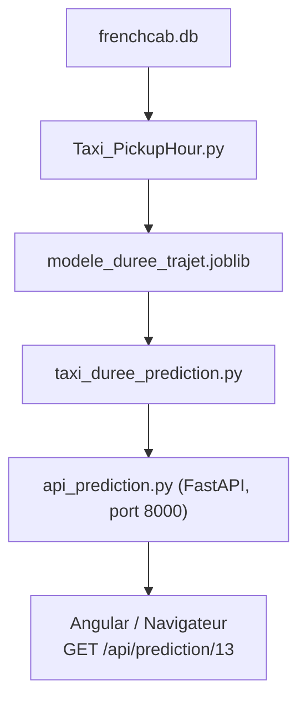
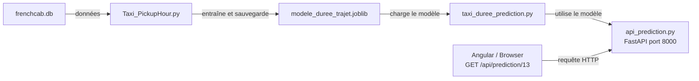

# Frenchcab

Chaque utilisateur dispose d'une branche créée sur origin/dev/, l'ensmeble des règles de contribution se trouvent dans le fichier [CONTRIBUTING.md](./CONTRIBUTING.md).

## Structure du projet

Le projet est composé de trois principaux services, gérés via Docker Compose.

/frenchcab
├── .github/                # Configuration CI/CD
│   └── workflows/
│       └── ci.yml          # Pipeline de test et de build
├── .gitignore
├── compose.yml
├── compose_override.yml
├── .dockerignore
├── README.md (global)

## Installation

├── gateway/
│   │   └── Dockerfile
│   │   └── src/
│   │   # Rôle : API Express (routes) - Route les requêtes HTTP vers et depuis les micro-services.

├── backend/
│   │   ├── Dockerfile
│   │   ├── api/            # Endpoint FastAPI pour la prédiction ML
│   │   ├── data/           # Contient les données brutes et traitées (ETL)
│   │   └── ML/             # Logique métier Machine Learning (Entraînement et prédiction)
│   ├── .env
│   ├── README.md (backend/ML)

└── frontend/
    └── web/                # Code Angular (Frontend)
    /environement

├── tests/                  # Tous les tests (Pytest)

## Démarrage du projet

### Initialisation Git

Cloner le repo :
[Repo Git Frenchcab](https://github.com/tomtoomuch/frenchcab.git)

Demander l'accès en tant que contributeur au propriétaire tomtoomuch.

### Docker Compose

Le projet est désormais organisé en 3 conteneurs principaux :

| Service | Image | Port | Rôle |
| ------- | ----- | ---- | ---- |
| gateway | python:3.14-slim | 3000 | API Express (routes) |
| backend | python:3.14-slim | 3001 | API FastAPI (prédiction) |
| frontend | nginx | 4200 | Angular |

1. Importer les images du dockerhub

        ```bash
        docker compose pull
        ```

2. Lancer les conteneurs

        ```bash
        docker compose up
        ```

### Lancement en VM

Pour lancer la VM groupe1@<url-serveur> et écrire le mot de passe.

#### Lancer le Front-end

Pour lancer le frontend, faire un push sur la branche dev, puis accéder à l'application à l'URL :
[FrenchCab - Taxis Jaunes](https://g1.valentinduflot.fr/)

## Données

### Dictionnaires de données (Yellow Cab Trip Data)

#### Les trajets

| **Nom de champ** | **Description** | **Type** |
| :--------------- | :-------------- | :------: |
| VendorID | Code qui indique quel opérateur a fourni l'enregistrement de données. 1 = Creative Mobile Technologies, LLC; 2 = VeriFone Inc. | int |
| tpep_pickup_datetime | Date et heure à la mise en route du compteur de course. | timestamp |
| tpep_dropoff_datetime | Date et heure à l'arrêt du compteur de course. | timestamp |
| passenger_count | Nombre de passagers dans le véhicule. Cette donnée est fournit par le chauffeur. | int |
| trip_distance | Distance parcourue, en miles (~1,609m), de la course relevée par le compteur. | float |
| RateCodeID | Code du taux de tarification finale, en effet à la fin de la course. 1=Taux standard, 2=Taux pour l'aéroport JFK, 3=Taux pour l'aéroport Newark, 4=Taux pour les littoraux de Nassau ou Westchester, 5=Tarif négocié, 6=Tarif de groupe | int |
| store_and_fwd_flag | Cet indicateur signale si l'enregistrement de la course a été stocké dans la mémoire du véhicule avant d'être transmis, en général par manque d'une connexion au serveur. 1= store and forward trip, 0= not a store and forward trip | int |
| PULocationID | La zone TLC Taxi dans laquelle le compteur de course a été déclenché. | int |
| DOLocationID | La zone TLC Taxi dans laquelle le compteur de course a été arrêté. | int |
payment_type | Valeur entière qui correspond à un mode de paiement. 1= Credit card, 2= Cash, 3= No charge, 4= Dispute - une opposition est faite auprès de la banque par le client, 5= Unknown, 6= Voided trip - la course est annulée et n'est pas chargée | int |
| fare_amount | Le tarif calculé par le compteur de courses (temps et distance) | float |
| extra | Charges et coûts supplémentaires. Actuellement, Cette colonne inclut la surcharge des heures de pointes ou des heures de nuit : 0,50$ ou 1$. | float |
| mta_tax | Taxe MTA (réseau métropolitain) déclenchée automatiquement en fonction du RateCodeID utilisé | float |
| tip_amount | Ce champ est peuplé automatiquement pour prendre en compte les pourboires CB | float |
| tolls_amount | Montant total des péages pris en charge sur le trajet. | float |
| improvement_surcharge | Depuis 2015, une surcharge d'amélioration de $0,30 participe à la mise en conformité et à l'amélioration des équipements pour les personnes à mobilité réduite. Elle est appliquée aux taxi Jaunes et Verts | float |
| total_amount | Montant total de la course facturé au client. N'inclut pas les pourboires en espèce. | float |
| congestion_surcharge | Montant total collecté lors d'un trajet depuis et vers l'état de New York en traversant Manhattan par le sud de la 96th rue. | float |

#### Les localisations

Données géographiques à croiser avec les points de départ et d'arrivée des trajets

| **Nom du champ** | **Description** | **Type** |
| :--------------- | :-------------- | :------: |
| locationID | Identifiant de la zone | int |
| borough | Quartier | str |
| zone | zone du quartier | str |
| service_zone | zone de service | str |

#### Les termes 'métier'

* **TPEP :** Taxicab Passenger Enhancement Program - Programme unifiée d'amélioration de la prise en charge des clients et qui concerne l'ensemble des compagnies de Taxi de la ville de New York

* **MTA tax :** Metropolitan Commuter Transportation Mobility Tax

* **Congestion surcharge :** taxe de traversée d'une partie spécifique de Manhattan

## Flux de Données (ETL et ML)

### Extract, Transform, Load

Le processus de préparation des données suit ces étapes :
Fonctionnement de l'extraction
1. Télécharger les données
   Le fichier de données brutes téléchargées depuis le portail de données ouvertes de la ville de New York
   Les données sont ensuite importées dans deux CSV : query.csv et taxi_zone_lookup.csv.
   backend/data/query.csv
2. Extraire les données
   Lancer le fichier extraction.py
   backend/data/clean/
   Cette étape crée le raport_2023.json et le fichier yellow_tripdata_2023.
3. Initialiser la BDD et importer les données
   Lancer le fichier load_taxi_data.py qui va créer la base de données frenchcab.db.
Initialiser la BDD :
Une fois les données import


Le README du Backend :
# FrenchCab — BACKEND 

## ETL

### /backend/etl/extraction.py

```from __future__ import annotations```
Cela permet d'utiliser les types de données annotées dans ce script

```import argparse```
Cette bibliothèque permet de créer un programme commande ligne qui peut recevoir des arguments en ligne de commande

```import json```
Cette bibliothèque permet de travailler avec du JSON

```import time```
Cette bibliothèque permet de mesurer le temps d'exécution de certains blocs de code

```from collections import Counter```
Cette bibliothèque permet de compter les occurrences de chaque élément d'une liste

>python backend/etl/extraction.py --nrows 100000

##### Étapes du traitement

1. le script lit les **19 colonnes** ; les 4 colonnes techniques du portail (id, version, created_at, updated_at) sont ignorées.

2. le script normalise :
    * les noms repassent au format du dictionnaire TLC (vendorid → VendorID, pulocationid → PULocationID…),
    * les dates deviennent des dates,
    * les codes convertis en entiers,
    * les montants sont convertis en décimaux

3. le script filtre ; les lignes aberrantes sont comptées puis retirées.

4. le script écrit ; une première écriture crée le fichier avec les ent^tes de colonnes, chaque enregistrement s'ajoute ensuite à la fin du dataframe

##### Règles de nettoyage

1. **date_invalide**
    * Date de départ ou d'arrivée illisible.
    * Impossible de calculer la durée.
2. **hors_annee**
    * Départ hors de 2023 _(l'export contient des courses du 31/12/2022)_
3. **duree_negative_ou_nulle**
    * Arrivée avant ou à l'heure du départ.
    * Erreur de compteur.
4. **duree_sup_6h**
    * Course de plus de 6 h.
    * Compteur resté allumé _(vu : 23 h pour 1,2 mile)_.
5. **distance_nulle_ou_aberrante**
    * Distance ≤ 0 ou > 200 miles.
    * Distance non enregistrée.
6. **montant_negatif_ou_nul**
    * Tarif ou total ≤ 0.
    * Lignes d'annulation ou de remboursement.
7. **montant_aberrant**
    * Total > 1 000 $.
    * Saisie erronée.
8. **vendor_inconnu**
    * VendorID hors 1, 2, 6, 7.
    * Code absent du dictionnaire.
9. **ratecode_invalide**
    * RatecodeID hors 1–6 et 99.
    * Code absent du dictionnaire.
10. **payment_type_invalide**
    * payment_type hors 0–6.
    * Code absent du dictionnaire.

11. **Doublons**

Est considéré 'doublon' une ligne qui est identique à une autre dans l'échantillon de donnéees traité.

![ATTENTION] Deux valeurs sont vidées sans supprimer la course : 
    * passenger_count = 0
    * RatecodeID = 99 
Ils deviennent « inconnu » (case vide).

Deux fichiers sont écrits dans backend/data/clean/
    * yellow_tripdata_2023.csv   les courses propres, 23 colonnes (les 19 du dictionnaire + 4 ajoutées). il peut peser plusieurs Go ,vérifier l'espace disque
    * rapport_extraction_2023.json  lignes lues, gardées, rejetées, taux de rejet et détail par motif.


#### Colonnes ajoutées

**cbd_congestion_fee**
0 pour 2023 (taxe créée le 5 janvier 2025), gardée pour un schéma identique d'une année à l'autre
**trip_duration_min**
durée de la course en minutes
**pickup_hour**
heure de départ (0–23)

**pickup_weekday**
jour de départ (0 = lundi, 6 = dimanche)

![ATTENTION]
 Remboursements--- une annulation apparaît en deux lignes, une négative et une positive. La négative est retirée, la positive reste : la course compte donc une fois alors qu'elle a été remboursée

• doublons --- ils ne sont détectés qu'à l'intérieur d'un même morceau , deux lignes identiques dans deux morceaux différents
• frais d'aéroport, VendorID 1 : pour les courses à l'aéroport, extra semble déjà contenir les 1,25 $ de airport_fee. La somme des colonnes dépasse alors total_amount de 1,25 $ ; se fier à total_amount
•pourboires en espèces  ----- ils ne sont pas enregistrés ; tip_amount ne concerne que les paiements par carte
• improvement_surcharge : quelques lignes sont à 0,30 $ au lieu de 1,00 $ (ancien tarif) ; elles sont gardées
•test le script a été vérifié sur un petit extrait, pas encore sur les 6 Go complets

 lancer d'abord avec --nrows 100000 et relire le rapport    python backend/etl/extraction.py --nrows 100000

## Problématiques

Incohérences entre colonnes et tables sql -> ajouter les quelques colonnes manquantes dans la table "trajets" et  s'assurer de la présence du champ `uid_trajet` qui est un identifiant unique auutoincrémenté et fait office de clé primaire.

## Prédiction de la durée d'une course de taxi

Ce module prédit **combien de minutes va durer une course de taxi jaune** (New York, 2023), à partir des informations connues **au moment du départ** : la distance, l'heure, le jour et les zones de départ et d'arrivée

```text
backend/
├── data/
│   └── frenchcab.db                  ← base SQLite (tables trajets + localisations)
└── ML/
    ├── Taxi_PickupHour.py          ← 1. entraînement du modèle
    ├── modele_duree_trajet.joblib   ←    modèle sauvegardé
    ├── taxi_duree_prediction.py.py     ← 2. prédiction d'une course par (zone_depart, zone_arrivee, date, heure)
    ├── api_prediction.py            ← 3. API FastAPI
    ├── requirements.txt             ← 4. dépendances Python
    ├── Dockerfile                   ← 4. image Docker de l'API
    └── .dockerignore
```

Le chemin complet :



## 1. Le modèle — `Taxi_PickupHour.py`

### Le but

Une fonction : **informations de la course → durée en minutes**

C'est de l'**apprentissage supervisé** : le modèle apprend à partir de courses passées dont on connaît la vraie durée
Comme la réponse est un nombre, c'est une **régression**

- **X** (les variables, ou *features*) : ce qu'on donne au modèle
- **y** (la cible) : `trip_duration_min`, déjà calculée par l'ETL (`load_taxi_data.py`)

### Les étapes

| Étape | Fonction | Description |
|---|---|---|
| 1. Charger | `charger_donnees()` | |
| 2. Nettoyer | `nettoyer()` | |
| 3. Variables | `construire_variables()` | Crée `heure` et `est_weekend`, ainsi que la paire de zones `trajet_zones` (ex. `"zone_names"`) |
| 4. Train / test | `train_test_split` | 80 % des courses pour apprendre, 20 % pour vérifier sur des courses jamais vues |
| 5. Baselines | `DummyRegressor`, médiane par paire, `LinearRegression` | Modèles très simples que le vrai modèle doit battre |
| 6. Entraîner | `creer_pipeline()` | Prépare les données, puis entraîne un Gradient Boosting |
| 7. Évaluer | `evaluer()` | Calcule MAE, RMSE et R², et l'importance de chaque variable |
| 8. Sauvegarder | `joblib.dump` | Écrit le fichier `modele_duree_trajet.joblib` |

### Les variables utilisées

| Type | Variables | Traitement |
|---|---|---|
| Nombres | `trip_distance`, `heure`, `pickup_weekday`, `est_weekend`, `mois` | Utilisées telles quelles |
| Peu de catégories | `quartier_dep/arr`, `zone_service_dep/arr`, `RateCodeID`, `vendorID` | **OneHotEncoder** : une colonne 0/1 par valeur |
| Beaucoup de catégories | `pu_locationID`, `do_locationID`, `trajet_zones` | **TargetEncoder** : chaque zone est remplacée par la durée moyenne de ses courses |

### Le modèle : `HistGradientBoostingRegressor`

- `max_iter=300` : au maximum 300 arbres
- `learning_rate=0.1` : chaque arbre corrige 10 % de l'erreur restante
- `early_stopping=True` : l'entraînement s'arrête quand le modèle ne progresse plus

Le **Pipeline** regroupe la préparation des données et le modèle dans **un seul objet**. On sauvegarde cet objet, et on le réutilise tel quel pour prédire

### Les mesures

- **MAE** : erreur moyenne en minutes. C'est la plus facile à lire
- **RMSE** : ressemble à la MAE, mais punit davantage les grosses erreurs
- **R²** : entre 0 et 1, la part de la variation expliquée (1 = parfait)
- Si le score **train** est bien meilleur que le score **test**, le modèle a appris par cœur : c'est du **surapprentissage**

### Lancer

```bash
cd backend/ML
python Taxi_PickupHour.py                  # avec la distance (1 million de courses)
python Taxi_PickupHour.py 2000000          # échantillon plus grand (0 = toutes les courses)
python Taxi_PickupHour.py --sans-distance  # seulement les zones et l'heure
```

## 2. La prédiction — `taxi_duree_prediction.py`

Ce fichier **utilise** le modèle déjà entraîné. Il ne réentraîne rien

| Fonction | Rôle |
|---|---|
| `charger_modele()` | Ouvre `modele_duree_trajet.joblib` |
| `constuire_course_prediction(db, zone_depart, zone_arrivee, date_depart, heure_depart)` | `SELECT ... FROM trajets WHERE zone IN (...)`, puis la jointure avec `localisations` |
| `predire(modele, df)` | Applique `construire_variables()` (**la même** fonction qu'à l'entraînement), puis `modele.predict()` |
| `afficher(df)` | Affiche une phrase par course |
| `prediction(id_trajet)` | Fait tout : charger, prédire et afficher |

Points importants :

- Les constantes et `construire_variables` sont **importées** depuis `Taxi_PickupHour.py`
  Ainsi, l'entraînement et la prédiction préparent les données exactement de la même façon
- `modele.feature_names_in_` donne la liste des colonnes vues pendant l'entraînement, on donne au modèle exactement ces colonnes, dans le même ordre
- Le `if __name__ == "__main__":` de `Taxi_PickupHour.py` empêche l'entraînement de se relancer quand on importe ce fichier

### Lancer

```bash
cd backend/ML
python taxi_duree_prediction.py      # lance prediction(20)
```

Résultat :

```
Course prévue le 2027-03-15 à 10:00 de Bronx/Allerton/Pelham Gardens/Boro Zone vers Manhattan/Battery Park City/Yellow Zone - durée prédite : 48 min
```

> Remarque : si la course a servi à l'entraînement, le modèle l'a déjà « vue ». La prédiction sera donc un peu trop bonne

---

## 3. L'API — `api_prediction.py` (FastAPI)

Angular tourne dans le **navigateur**, qui ne peut pas lancer un fichier Python. Il envoie des **requêtes HTTP**. FastAPI transforme donc la prédiction en **adresse web**

### La route

```
GET /api/prediction/{uid_trajet}

```
Pour ouvrir FASTApi [http://127.0.0.1:8000/docs]

| Partie du code | Rôle |
|---|---|
| `app = FastAPI(...)` | Crée l'application web |
| `http://localhost:4200` | Autorise Angular (port 4200) à appeler l'API (port 8000) |
| Chargement du modèle | Le modèle est chargé **une seule fois**, au démarrage, et pas à chaque requête |
| `@app.get("/api/prediction")` | Attend les paramètres dans le body `zone_depart: str, zone_arrivee: str, date_depart: date, heure_depart: time` |
| `HTTPException(404)` | Erreur renvoyée si la course n'existe pas |
| `return {...}` | Le dictionnaire est renvoyé en JSON (on convertit avec `int()` et `float()`, car le JSON ne connaît pas les types de pandas) |

### Réponses possibles

| Route | Code HTTP | Réponse |
|---|---|---|
| `/api/prediction/13` | 200 | JSON de la course (voir ci-dessous) |
| `/api/prediction/99999999` | 404 | `{"detail": "course 99999999 introuvable"}` |
| `/api/prediction/abc` | 422 | Erreur de validation : ce n'est pas un nombre |

```json
{
  "zone_depart": "Allerton/Pelham Gardens",
  "zone_arrivee": "Battery Park City",
  "date_depart": "2027-03-15",
  "heure_depart": "10:00:00",
}
```

### Lancer sans Docker

```bash
cd backend/ML
pip install fastapi uvicorn
uvicorn api_prediction:app --reload --port 8000
```

## 4. Docker

Le projet a maintenant **3 conteneurs** :

| Service | Image | Port | Rôle |
|---|---|---|---|
| `backend` | `node:22` | 3001 | API Express (liste des courses) |
| `ml` | `python:3.14-slim` | 8000 | API FastAPI (prédiction) |
| `frontend` | nginx | 4200 | Angular |

> Le service `backend` est une image **Node** : elle ne contient pas Python. C'est pour ça que la prédiction a besoin de son propre conteneur, `ml`

### `backend/ML/requirements.txt`

```text
fastapi
uvicorn
pandas
joblib
scikit-learn==VOTRE_VERSION
```

> Mettez **la même version** de scikit-learn que celle qui a entraîné le modèle (`pip show scikit-learn`). Avec une autre version, le fichier `.joblib` peut refuser de se charger

### `backend/ML/Dockerfile`

```dockerfile
FROM python:3.14-slim
WORKDIR /app/ML
COPY requirements.txt .
RUN pip install --no-cache-dir -r requirements.txt
COPY . .
EXPOSE 8000
CMD ["uvicorn", "api_prediction:app", "--host", "0.0.0.0", "--port", "8000"]
```

### Service dans `docker-compose.yml`

```yml
  ml:
    build: ./backend/ML
    container_name: conteneur-ml
    ports:
      - "8000:8000"
    volumes:
      - ./backend/data:/app/data
    restart: always
```

- `ports "8000:8000"` : le port 8000 du PC mène au port 8000 du conteneur

### Démarrer le projet

```bash
cd C:\python-projs\frenchcab
docker compose up --build
```

Puis ouvrir [http://localhost:8000/api/prediction/13](http://localhost:8000/api/prediction/13)

## Ordre de lancement (résumé)

1. `python Taxi_PickupHour.py` → crée le modèle `.joblib` (seulement si les données changent)
2. `python taxi_duree_prediction.py.py` → vérifie qu'une prédiction marche
3. `uvicorn api_prediction:app --port 8000` → vérifie l'API sans Docker
4. `docker compose up --build` → lance tout : backend, ml et frontend

## 5. Identification, évaluation et contrôle qualité du modèle

### Identifier le modèle utilisé

Les informations sont stockées dans `backend/modele_duree_trajet.meta.json`, à côté du modèle, et exposées par l'API :

```text
GET /modele                      (backend, port 3001)
GET /prediction/modele           (gateway, port 3000)
```

Exemple de réponse :

```json
{
  "version": "c3cecda3ba02",
  "date_entrainement": "2026-10-13T13:16:35",
  "date_entrainement_source": "date_fichier",
  "mae_minutes": 3.921,
  "mae_source": "evaluation",
  "jeu_evaluation": "tlc_eval_2026-01.csv",
  "metadonnees_a_jour": true
}
```

* `version` : 12 premiers caractères du SHA-256 du fichier `.joblib` réellement chargé. Elle est recalculée au démarrage : un modèle remplacé change automatiquement de version.
* `date_entrainement` : écrite par le script d'entraînement (`date_entrainement_source = "entrainement"`). Pour un modèle livré avant l'ajout des métadonnées, c'est la date du fichier (`"date_fichier"`).
* `mae_minutes` : MAE du jeu TLC d'évaluation (`mae_source = "evaluation"`), ou à défaut MAE du jeu de test de l'entraînement (`"test_entrainement"`).
* Le fichier meta n'est repris que si son empreinte correspond au modèle chargé. Sinon `metadonnees_a_jour` vaut `false` et la date et la MAE restent `null` : les infos d'un ancien modèle ne sont jamais attribuées à un autre.

Chaque réponse de `/prediction` contient aussi `modele_version`.

### Évaluer le modèle (sans réentraînement) — `evaluation_modele.py`

```bash
cd backend/ML
python evaluation_modele.py --sortie rapport.json
```

Le script :

1. charge le modèle existant (`modele_duree_trajet.joblib`), sans le réentraîner ;
2. lit un jeu de courses TLC distinct des données d'entraînement : `backend/eval/tlc_eval_2026-01.csv` (20 000 courses de janvier 2026, le modèle étant entraîné sur 2023) ;
3. calcule la durée réelle (arrivée - départ, en minutes), nettoie les courses aberrantes avec les mêmes règles que l'entraînement, puis prédit chaque durée ;
4. compare prédictions et durées réelles et produit un rapport JSON (console et fichier `--sortie`).

Extrait du rapport :

```json
"metriques": {
  "mae_minutes": 3.921,
  "rmse_minutes": 7.174,
  "r2": 0.7225,
  "mae_baseline_mediane_minutes": 8.852
}
```

`mae_baseline_mediane_minutes` est la MAE d'un prédicteur qui répondrait toujours la durée médiane : c'est le point de comparaison du seuil.

| Option | Rôle |
| --- | --- |
| `--donnees <fichier>` | autre jeu TLC (CSV ou parquet ; parquet demande `pyarrow`) avec les colonnes `tpep_pickup_datetime`, `tpep_dropoff_datetime`, `trip_distance`, `PULocationID`, `DOLocationID` |
| `--zones <fichier>` | `taxi_zone_lookup.csv` (par défaut `backend/eval/taxi_zone_lookup.csv`) |
| `--echantillon N` | n'évalue que N courses (0 = toutes) |
| `--sortie <fichier>` | écrit le rapport JSON |
| `--maj-metadonnees` | enregistre la MAE dans `modele_duree_trajet.meta.json`, donc dans `/modele` |

### Contrôle automatique du seuil — `controle_qualite.py`

```bash
python controle_qualite.py              # évalue puis compare au seuil
python controle_qualite.py --seuil 4.5  # seuil explicite
python controle_qualite.py --rapport rapport.json   # à partir d'un rapport existant
```

| Code retour | Signification |
| --- | --- |
| `0` | MAE <= seuil |
| `1` | MAE > seuil : échec qualité, la CI échoue |
| `2` | erreur technique (modèle, données ou rapport introuvables) |

Le seuil (5,0 min) et sa justification sont dans `seuil_qualite.json` : environ 25 % de marge sur la MAE mesurée (3,92 min) et nettement sous la baseline (8,85 min), au-delà de laquelle le modèle n'apporterait plus de gain réel. À revoir si le modèle ou le jeu d'évaluation change.

### Tests et CI

* Tests : `cd backend && python -m pytest` (7 tests dont la vérification du seuil sur un échantillon).
* Pipeline `.github/workflows/ci-cd.yml` : `qualite-modele` (tests + contrôle de la MAE), puis `build-and-push` (images Docker Hub), puis `deploy` (VM). Si le contrôle échoue, rien n'est construit ni déployé.

### Après un réentraînement

```bash
python Taxi_PickupHour.py 200000
python evaluation_modele.py --maj-metadonnees
curl http://localhost:3001/modele
```

La version change, la date d'entraînement est enregistrée et la MAE sur le jeu TLC est mise à jour. Commiter ensuite le `.joblib` et son `.meta.json` ensemble.

## 6. MLOps workflow

Pour lancer la comparaison du modèle en production et du modèle 'candidat', dans le terminal depuis la racine du projet :

```bash
cd backend/
py pipeline.py
```

Le pipeline :

* vérifie les bases et jeux de données ainsi que l'existence d'un seuil de qualité et d'un modèle ML en production
* entraîne et teste le modèle modele_duree_trajet.joblib avec un échantillon de 1017292 enregistrements 
* évalue le modèle 'candidat' et le modèle en production avec un même jeu de données et émet un rapport par version du modèle pour comparaison
* effectue un contrôle de la qualité du modèle 'candidat' et met à jour le 'rapport_candidat' émis pendant son évaluation
* effectue les 12 tests unitaires du pipeline
* effectue une prédiction avec le modèle candidat pour comparaison avec le modèle en production
* affiche dans la console et dans un fichier JSON le résumé de l'exécution du pipeline ainsi que la comparaison des 2 modèles

Fonctionnement de l'extraction
1. Télécharger les données
   Le fichier de données brutes téléchargées depuis le portail de données ouvertes de la ville de New York
   Les données sont ensuite importées dans deux CSV : query.csv et taxi_zone_lookup.csv.
   backend/data/query.csv
2. Extraire les données
   Lancer le fichier extraction.py
   backend/data/clean/
   Ceci crée le raport_2023.json et le fichier yellow_tripdata_2023.
3. Initialiser la BDD et importer les données
   Lancer le fichier load_taxi_data.py qui va créer la base de donnée frenchcab.db.
   Initialiser la bdd :
   Une fois les données importées et traitées en csv initialiser la bdd :
   cd backend/etl
   python load_taxi_data.py
   Une fois le fichier exécuté il va y avoir frenchcab.db qui va être créé dans le dossier data.
Détails techniques de l'ETL (/backend/etl/extraction.py)
Étapes du traitement
1. Le script lit les 19 colonnes ; les 4 colonnes techniques du portail (id, version, created_at, updated_at) sont ignorées.
2. Le script normalise :
   - Les noms repassent au format du dictionnaire TLC (vendorid → VendorID, pulocationid → PULocationID…)
   - Les dates deviennent des dates,
   - Les codes convertis en entiers,
   - Les montants sont convertis en décimaux
3. Le script filtre : les lignes aberrantes sont comptées puis retirées.
4. Le script écrit : une première écriture crée le fichier avec les ent^tes de colonnes, chaque enregistrement s'ajoute ensuite à la fin du dataframe
Règles de nettoyage
1. date_invalide
   - Date de départ ou d'arrivée illisible.
   - Impossible de calculer la durée.
2. hors_annee
   - Départ hors de 2023 (l'export contient des courses du 31/12/2022).
3. duree_negative_ou_nulle
   - Arrivée avant ou à l'heure du départ.
   - Erreur de compteur.
4. duree_sup_6h
   - Course de plus de 6 h.
   - Compteur resté allumé (vu : 23 h pour 1,2 mile).
5. distance_nulle_ou_aberrante
   - Distance ≤ 0 ou > 200 miles.
   - Distance non enregistrée.
6. montant_negatif_ou_nul
   - Tarif ou total ≤ 0.
   - Lignes d'annulation ou de remboursement.
7. montant_aberrant
   - Total > 1 000 $.
   - Saisie erronée.
8. vendor_inconnu
   - VendorID hors 1, 2, 6, 7.
   - Code absent du dictionnaire.
9. ratecode_invalide
   - RatecodeID hors 1–6 et 99.
   - Code absent du dictionnaire.
10. payment_type_invalide
    - payment_type hors 0–6.
    - Code absent du dictionnaire.
11. Doublons
    Est considéré 'doublon' une ligne qui est identique à une autre dans l'échantillon de donnéees traité.
![ATTENTION] Deux valeurs sont vidées sans supprimer la course :
    *   passenger_count = 0
    *   RatecodeID = 99
Ils deviennent « inconnu » (case vide).
Deux fichiers sont écrits dans backend/data/clean/ :
- yellow_tripdata_2023.csv : les courses propres, 23 colonnes (les 19 du dictionnaire + 4 ajoutées). Il peut peser plusieurs Go, vérifier l'espace disque
- rapport_extraction_2023.json : lignes lues, gardées, rejetées, taux de rejet et détail par motif.
Colonnes ajoutées
cbd_congestion_fee
0 pour 2023 (taxe créée le 5 janvier 2025), gardée pour un schéma identique d'une année à l'autre
trip_duration_min
durée de la course en minutes
pickup_hour
heure de départ (0–23)
pickup_weekday
jour de départ (0 = lundi, 6 = dimanche)
![ATTENTION]
- Remboursements --- une annulation apparaît en deux lignes, une négative et une positive. La négative est retirée, la positive reste : la course compte donc une fois alors qu'elle a été remboursée
- Doublons --- ils ne sont détectés qu'à l'intérieur d'un même morceau , deux lignes identiques dans deux morceaux différents
- Frais d'aéroport, VendorID 1 : pour les courses à l'aéroport, extra semble déjà contenir les 1,25 $ de airport_fee. La somme des colonnes dépasse alors total_amount de 1,25 $ ; se fier à total_amount
- Pourboires en espèces ----- ils ne sont pas enregistrés ; tip_amount ne concerne que les paiements par carte
- improvement_surcharge : quelques lignes sont à 0,30 $ au lieu de 1,00 $ (ancien tarif) ; elles sont gardées
- Test le script a été vérifié sur un petit extrait, pas encore sur les 6 Go complets
Lancer d'abord avec --nrows 100000 et relire le rapport :
python backend/etl/extraction.py --nrows 100000
Problématiques
- Incohérences entre colonnes et tables sql -> ajouter les quelques colonnes manquantes dans la table "trajets" et s'assurer de la présence du champ uid_trajet qui est un identifiant unique autoincrémenté et fait office de clé primaire.
💡 Prédiction de la durée d'une course de taxi (Machine Learning)
Ce module prédit combien de minutes va durer une course de taxi jaune (New York, 2023), à partir des informations connues au moment du départ : la distance, l'heure, le jour et les zones de départ et d'arrivée.
Architecture du Workflow ML
Le flux de travail peut être résumé ainsi :

1. Le modèle — Taxi_PickupHour.py (Entraînement)
Le but
Une fonction : informations de la course → durée en minutes
C'est de l'apprentissage supervisé : le modèle apprend à partir de courses passées dont on connaît la vraie durée.
Comme la réponse est un nombre, c'est une régression.
- X (les variables, ou features) : ce qu'on donne au modèle.
- y (la cible) : trip_duration_min, déjà calculée par l'ETL (load_taxi_data.py).
Les étapes
Étape	Fonction	Description
1. Charger	charger_donnees()	
2. Nettoyer	nettoyer()	
3. Variables	construire_variables()	Crée heure et est_weekend, ainsi que la paire de zones trajet_zones (ex. "zone_names").
4. Train / test	train_test_split	80 % des courses pour apprendre, 20 % pour vérifier sur des courses jamais vues.
5. Baselines	DummyRegressor, médiane par paire, LinearRegression	Modèles très simples que le vrai modèle doit battre.
6. Entraîner	creer_pipeline()	Prépare les données, puis entraîne un Gradient Boosting.
7. Évaluer	evaluer()	Calcule MAE, RMSE et R², et l'importance de chaque variable.
8. Sauvegarder	joblib.dump	Écrit le fichier modele_duree_trajet.joblib.


Les variables utilisées
Type	Variables	Traitement
Nombres	trip_distance, heure, pickup_weekday, est_weekend, mois	Utilisées telles quelles
Peu de catégories	quartier_dep/arr, zone_service_dep/arr, RateCodeID, vendorID	OneHotEncoder : une colonne 0/1 par valeur.
Beaucoup de catégories	pu_locationID, do_locationID, trajet_zones	TargetEncoder : chaque zone est remplacée par la durée moyenne de ses courses.


Le modèle : HistGradientBoostingRegressor
- max_iter=300 : au maximum 300 arbres.
- learning_rate=0.1 : chaque arbre corrige 10 % de l'erreur restante.
- early_stopping=True : l'entraînement s'arrête quand le modèle ne progresse plus.
Le Pipeline regroupe la préparation des données et le modèle dans un seul objet. On sauvegarde cet objet, et on le réutilise tel quel pour prédire.
Les mesures
- MAE : erreur moyenne en minutes. C'est la plus facile à lire.
- RMSE : ressemble à la MAE, mais punit davantage les grosses erreurs.
- R² : entre 0 et 1, la part de la variation expliquée (1 = parfait).
- Si le score train est bien meilleur que le score test, le modèle a appris par cœur : c'est du surapprentissage.
Lancer
cd backend/ML
python Taxi_PickupHour.py                  # avec la distance (1 million de courses)
python Taxi_PickupHour.py 2000000          # échantillon plus grand (0 = toutes les courses)
python Taxi_PickupHour.py --sans-distance  # seulement les zones et l'heure
```

### 2. La prédiction — `taxi_duree_prediction.py`

Ce fichier **utilise** le modèle déjà entraîné. Il ne réentraîne rien

| Fonction | Rôle |
| --- | --- |
| `charger_modele()` | Ouvre `modele_duree_trajet.joblib` |
| `charger_courses(db, [uid])` | `SELECT ... FROM trajets WHERE uid_trajet IN (...)`, puis la jointure avec `localisations` |
| `predire(modele, df)` | Applique `construire_variables()` (**la même** fonction qu'à l'entraînement), puis `modele.predict()` |
| `afficher(df)` | Affiche une phrase par course |
| `prediction(id_trajet)` | Fait tout : charger, prédire et afficher |

Points importants :
- Les constantes et construire_variables sont importées depuis Taxi_PickupHour.py
  Ainsi, l'entraînement et la prédiction préparent les données exactement de la même façon.
- modele.feature_names_in_ donne la liste des colonnes vues pendant l'entraînement, on donne au modèle exactement ces colonnes, dans le même ordre.
- Le if __name__ == "__main__": de Taxi_PickupHour.py empêche l'entraînement de se relancer quand on importe ce fichier.
Lancer
cd backend/ML
python taxi_duree_prediction.py      # lance prediction(20)
Résultat :
Course prévue le 2027-03-15 à 10:00 de Bronx/Allerton/Pelham Gardens/Boro Zone vers Manhattan/Battery Park City/Yellow Zone - durée prédite : 48 min
Remarque : si la course a servi à l'entraînement, le modèle l'a déjà « vue ». La prédiction sera donc un peu trop bonne.

3. L'API — api_prediction.py (FastAPI)
Angular tourne dans le navigateur, qui ne peut pas lancer un fichier Python. Il envoie des requêtes HTTP. FastAPI transforme donc la prédiction en adresse web.
La route
GET /api/prediction/{uid_trajet}
```

| Partie du code | Rôle |
| --- | --- |
| `app = FastAPI(...)` | Crée l'application web |
| `http://localhost:4200` | Autorise Angular (port 4200) à appeler l'API (port 8000) |
| Chargement du modèle | Le modèle est chargé **une seule fois**, au démarrage, et pas à chaque requête |
| `@app.get("/api/prediction/{uid_trajet}")` | Le nombre dans l'adresse devient le paramètre `uid_trajet: int` |
| `HTTPException(404)` | Erreur renvoyée si la course n'existe pas |
| `return {...}` | Le dictionnaire est renvoyé en JSON (on convertit avec `int()` et `float()`, car le JSON ne connaît pas les types de pandas) |

#### Réponses possibles

| Route | Code HTTP | Réponse |
| --- | --- | --- |
| `/api/prediction/13` | 200 | JSON de la course (voir ci-dessous) |
| `/api/prediction/99999999` | 404 | `{"detail": "course 99999999 introuvable"}` |
| `/api/prediction/abc` | 422 | Erreur de validation : ce n'est pas un nombre |

{
  "uid_trajet": 13,
  "date": "2023-01-01",
  "start_time": "00:21",
  "duree_predite": 15,
  "duree_reelle": 14,
  "depart": "Manhattan/Midtown Center/Yellow Zone",
  "arrivee": "Manhattan/Upper East Side South/Yellow Zone"
}
Lancer sans Docker
cd backend/ML
pip install fastapi uvicorn
uvicorn api_prediction:app --reload --port 8000
4. Docker et Dépendances ML
backend/ML/requirements.txt
fastapi
uvicorn
pandas
joblib
scikit-learn==VOTRE_VERSION
Mettez la même version de scikit-learn que celle qui a entraîné le modèle (pip show scikit-learn). Avec une autre version, le fichier .joblib peut refuser de se charger.

backend/ML/Dockerfile
FROM python:3.14-slim
WORKDIR /app/ML
COPY requirements.txt .
RUN pip install --no-cache-dir -r requirements.txt
COPY . .
EXPOSE 8000
CMD ["uvicorn", "api_prediction:app", "--host", "0.0.0.0", "--port", "8000"]
Service dans docker-compose.yml
  ml:
    build: ./backend/ML
    container_name: conteneur-ml
    ports:
      - "8000:8000"
    volumes:
      - ./backend/data:/app/data
    restart: always
- ports "8000:8000" : le port 8000 du PC mène au port 8000 du conteneur.

## Gestion du Cycle de Vie du Modèle (MLOps)

Cette section détaille les outils de contrôle qualité et de mise à jour du modèle, garantissant que le modèle en production est toujours fiable et performant.

1. Identification et Métadonnées
Les informations sont stockées dans backend/modele_duree_trajet.meta.json, à côté du modèle, et exposées par l'API :
- GET /modele (backend, port 3001)
- GET /prediction/modele (gateway, port 3000)
Exemple de réponse :
{
  "version": "c3cecda3ba02",
  "date_entrainement": "2026-10-13T13:16:35",
  "date_entrainement_source": "date_fichier",
  "mae_minutes": 3.921,
  "mae_source": "evaluation",
  "jeu_evaluation": "tlc_eval_2026-01.csv",
  "metadonnees_a_jour": true
}
- version : Les 12 premiers caractères du SHA-256 du fichier .joblib réellement chargé. Elle est recalculée au démarrage : un modèle remplacé change automatiquement de version.
- date_entrainement : écrite par le script d'entraînement (date_entrainement_source = "entrainement"). Pour un modèle livré avant l'ajout des métadonnées, c'est la date du fichier ("date_fichier").
- mae_minutes : MAE du jeu TLC d'évaluation (mae_source = "evaluation"), ou à défaut MAE du jeu de test de l'entraînement ("test_entrainement").
- Le fichier meta n'est repris que si son empreinte correspond au modèle chargé. Sinon metadonnees_a_jour vaut false et la date et la MAE restent null : les infos d'un ancien modèle ne sont jamais attribuées à un autre.
Chaque réponse de /prediction contient aussi modele_version.
2. Évaluer le modèle (sans réentraînement)
Il est crucial d'évaluer la performance du modèle sur des données récentes pour s'assurer qu'il n'est pas périmé.
cd backend/ML
python evaluation_modele.py --sortie rapport.json
Le script :
1. charge le modèle existant (modele_duree_trajet.joblib), sans le réentraîner.
2. lit un jeu de courses TLC distinct des données d'entraînement : backend/eval/tlc_eval_2026-01.csv (20 000 courses de janvier 2026, le modèle étant entraîné sur 2023).
3. calcule la durée réelle (arrivée - départ, en minutes), nettoie les courses aberrantes avec les mêmes règles que l'entraînement, puis prédit chaque durée.
4. compare prédictions et durées réelles et produit un rapport JSON (console et fichier --sortie).
Extrait du rapport :
"metriques": {
  "mae_minutes": 3.921,
  "rmse_minutes": 7.174,
  "r2": 0.7225,
  "mae_baseline_mediane_minutes": 8.852
}
- mae_baseline_mediane_minutes est la MAE d'un prédicteur qui répondrait toujours la durée médiane : c'est le point de comparaison du seuil.
Options disponibles :
- --donnees <fichier> : autre jeu TLC (CSV ou parquet ; parquet demande pyarrow) avec les colonnes tpep_pickup_datetime, tpep_dropoff_datetime, trip_distance, PULocationID, DOLocationID.
- --zones <fichier> : taxi_zone_lookup.csv (par défaut backend/eval/taxi_zone_lookup.csv).
- --echantillon N : n'évalue que N courses (0 = toutes).
- --sortie <fichier> : écrit le rapport JSON.
- --maj-metadonnees : enregistre la MAE dans modele_duree_trajet.meta.json, donc dans /modele.
3. Contrôle automatique du seuil de qualité
Ce script automatise la décision de mise en production.
python controle_qualite.py              # évalue puis compare au seuil
python controle_qualite.py --seuil 4.5  # seuil explicite
python controle_qualite.py --rapport rapport.json   # à partir d'un rapport existant
Code retour	Signification
0	MAE <= seuil (OK)
1	MAE > seuil : échec qualité, la CI échoue
2	erreur technique (modèle, données ou rapport introuvables)


Le seuil (5,0 min) et sa justification sont dans seuil_qualite.json : environ 25 % de marge sur la MAE mesurée (3,92 min) et nettement sous la baseline (8,85 min), au-delà de laquelle le modèle n'apporterait plus de gain réel. À revoir si le modèle ou le jeu d'évaluation change.
4. Tests et CI
- Tests unitaires : cd backend && python -m pytest (7 tests dont la vérification du seuil sur un échantillon).
- Pipeline CI/CD : Le .github/workflows/ci-cd.yml exécute séquentiellement : qualite-modele (tests + contrôle de la MAE), puis build-and-push (images Docker Hub), puis deploy (VM). Si le contrôle échoue, rien n'est construit ni déployé.
5. Flux de travail MLOps
Pour lancer la comparaison du modèle en production et du modèle 'candidat', dans le terminal depuis la racine du projet :
cd backend/
py pipeline.py
Ce pipeline :
- Vérifie les bases et jeux de données ainsi que l'existence d'un seuil de qualité et d'un modèle ML en production.
- Entraîne et teste le modèle modele_duree_trajet.joblib avec un échantillon de 1017292 enregistrements.
- Évalue le modèle 'candidat' et le modèle en production avec un même jeu de données et émet un rapport par version du modèle pour comparaison.
- Effectue un contrôle de la qualité du modèle 'candidat' et met à jour le 'rapport_candidat' émis pendant son évaluation.
- Effectue les 12 tests unitaires du pipeline.
- Effectue une prédiction avec le modèle candidat pour comparaison avec le modèle en production.
- Affiche dans la console et dans un fichier JSON le résumé de l'exécution du pipeline ainsi que la comparaison des 2 modèles.
🏗️ Configuration des services (Docker Compose)
Gateway & Backend (Nodes & APIs)
La Gateway et le Backend nécessitent de savoir comment communiquer avec les services de Machine Learning :
Backend (Node.js/Express)
Les routes de cette API :
- GET http://localhost:3001/api/prediction: Route principale appelée par le front-end, interroge les données de courses (pagination à 100, première course sinon crash car trop de courses) par ID.
- GET /api/prediction/modele (backend, port 3001) : Fournit les métadonnées du modèle actuellement utilisé.
🛣️ Ordre de lancement (Résumé)
Le lancement complet doit se faire dans cet ordre :
1. python Taxi_PickupHour.py $\to$ crée le modèle .joblib (seulement si les données changent).
2. python taxi_duree_prediction.py $\to$ vérifie qu'une prédiction marche.
3. uvicorn api_prediction:app --port 8000 $\to$ vérifie l'API sans Docker.
4. docker compose up --build $\to$ lance tout : backend, ml et frontend.
Détails techniques spécifiques
Connexion DB
Utiliser connexion.js pour se connecter à la db. Pas d'identifiant ou mdp nécessaire car c'est une db sqlite3.
// Cible le dossier 'data' puis le fichier 'frenchcab.db' depuis l'emplacement de ce fichier
const dbPath = path.resolve(__dirname, 'frenchcab.db'); (Changer le nom selon votre bdd).
Dictionnaire de données
(Tableau et texte du dictionnaire de données de la racine)

## Synthèse du processus de prédiction

| **Étape** | **Description** | **Outil responsable** | **Résultat** |
| :---- | :---------- | :---------------: | :------: |
| 1. ETL & Chargement | Nettoyer les données brutes et remplir la base de données. | extraction.py, load_taxi_data.py | frenchcab.db |
| 2. Entraînement ML | Apprendre la corrélation entre les features et la durée réelle. | Taxi_PickupHour.py | modele_duree_trajet.joblib |
| 3. Exposer la prédiction | Créer un point d'accès API pour le service ML. | api_prediction.py (FastAPI) | GET /api/prediction/{uid_trajet} |
| 4. Frontend | Interroger l'API pour afficher la durée prédite. | Angular / Browser | Affichage de la course prévue. |
