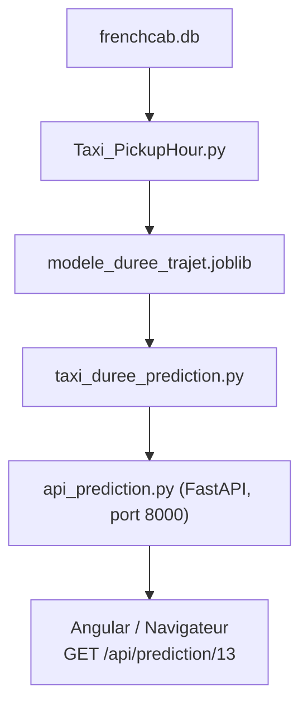

# Frenchcab — Documentation unifiée

## Sommaire

- [Présentation et ressources](#présentation-et-ressources)
- [Structure du projet](#structure-du-projet)
- [Contribution et démarrage](#contribution-et-démarrage)
- [Architecture et Docker](#architecture-et-docker)
- [Données et dictionnaire métier](#données-et-dictionnaire-métier)
- [ETL et préparation des données](#etl-et-préparation-des-données)
- [Modèle de prédiction](#modèle-de-prédiction)
- [Évaluation, contrôle qualité et MLOps](#évaluation-contrôle-qualité-et-mlops)
- [Service MLflow](#service-mlflow)
- [CI/CD et tests](#cicd-et-tests)
- [Routes Gateway & Backend](#routes-gateway-et-backend)

## Présentation et ressources

Frenchcab est un projet autour des données de courses de taxis jaunes de New York. Le traitement des données, la base SQLite, les services backend, l'API de prédiction et l'interface Angular permettent d'explorer les courses et de prédire leur durée afin d'yappuyer un service de réservation de courses.

Ressources du projet :

- [Trello](https://trello.com/b/6aba1ba41df9f2136e0e2c48)
- [Dépôt GitHub](https://github.com/tomtoomuch/frenchcab)
- [Règles de contribution](./CONTRIBUTING.md)

## Structure du projet

Arborescence indicative rassemblant les composants documentés dans les README. Elle ne remplace pas la vérification de l'arborescence effective du dépôt.

```text
/frenchcab
├── .github/
│   └── workflows/           # Configuration CI/CD
├── .gitignore
├── .dockerignore
├── docker-compose.yml
├── docker-compose_override.yml
├── gateway/                 # Gateway et routes d'exposition
├── backend/
│   ├── config/              # Configuration du modèle à utiliser pour les prédictions
│   ├── api/                 # Exposition des fonctionnalités via des routes FastAPI
│   ├── eval/                # Données d'évaluation des modèles
│   ├── etl/                 # Extraction et chargement des données
│   ├── ML/                  # Entraînement, prédiction et API FastAPI
│   ├── modeles/             # Dossier contenant les modèles en production et candidats
│   ├── data/                # Données brutes et nettoyées
│   └── pipeline.py          # Exécute l'ensemble du pipeline de procution du modèle
├── frontend/                # Application Angular
├── mlflow/                  # Service MLflow autonome
│   ├── mlflow.db
│   └── artifacts
└── tests/                   # Tests
```

## Contribution et démarrage

### Récupérer le projet

Cloner le dépôt :

```bash
git clone https://github.com/tomtoomuch/frenchcab.git
cd frenchcab
```

Demander l'accès en tant que contributeur au propriétaire `tomtoomuch`.

Consulter [CONTRIBUTING.md](./CONTRIBUTING.md) pour l'ensemble des règles de contribution.

### Démarrage avec Docker Compose

Importer les images :

```bash
docker compose pull
```

Puis lancer les conteneurs :

```bash
docker compose up
```

Pour reconstruire les images :

```bash
docker compose up --build
```

Le service MLflow peut être lancé séparément depuis la racine du projet :

```bash
docker compose up -d --build mlflow
```

### VM et frontend distant

Pour lancer la VM, utiliser `groupe1@<url_vm_groupe1>` et saisir le mot de passe. Pour ces informations, consulter le fichier texte envoyé par le groupe précédent.

Pour lancer le frontend distant, faire un push sur la branche `dev`, puis ouvrir :
[https://g1.valentinduflot.fr/](https://g1.valentinduflot.fr/).

## Architecture et Docker

Les README décrivent plusieurs vues de l'architecture. Les tableaux ci-dessous sont conservés séparément, car les noms de services et les ports ne sont pas identiques dans les sources.

### Tableau d'architecture

| Service | Image indiquée | Port | Rôle indiqué |
| ------- | -------------- | ---: | ------------ |
| `gateway` | `node:latest` | 3000 | API NodeJS / Express (routes) |
| `backend` | `python:3.14-slim` | 3001 | API FastAPI (ETL et ML) |
| `ml` | `python:3.14-slim` | - | Volume uniquement /ML dans app/ |
| `frontend` | `nginx` | 4200 | Angular |
| `mlflow` | `mlflow:v3.5.0` | 5000 | API FastAPI (mlops) |

## Données et dictionnaire métier

### Source des données

Les données brutes sont téléchargées depuis le [portail de données ouvertes de la ville de New York — 2023 Yellow Taxi Trip Data](https://data.cityofnewyork.us/Transportation/2023-Yellow-Taxi-Trip-Data/4b4i-vvec/about_data).

Les fichiers de jeux de données, `query.csv` et `taxi_zone_lookup.csv` sont ensuite lues par les scripts de nettoyage puis stockées dans en fichiers CSV ou DB.

### Dictionnaire de données des courses

| Nom de champ | Description | Type indiqué |
| --- | --- | --- |
| `VendorID` | Code qui indique quel opérateur a fourni l'enregistrement : 1 = Creative Mobile Technologies, LLC ; 2 = VeriFone Inc. | int |
| `tpep_pickup_datetime` | Date et heure à la mise en route du compteur de course. | timestamp |
| `tpep_dropoff_datetime` | Date et heure à l'arrêt du compteur de course. | timestamp |
| `passenger_count` | Nombre de passagers dans le véhicule ; donnée fournie par le chauffeur. | int |
| `trip_distance` | Distance parcourue, en miles (~1,609 m), relevée par le compteur. | float |
| `RateCodeID` | Code du taux de tarification finale : 1 = standard ; 2 = aéroport JFK ; 3 = aéroport Newark ; 4 = Nassau ou Westchester ; 5 = tarif négocié ; 6 = tarif de groupe. | — |
| `store_and_fwd_flag` | Indique si l'enregistrement a été stocké dans la mémoire du véhicule avant transmission : 1 = store and forward trip ; 0 = not a store and forward trip. | int |
| `PULocationID` | Zone TLC Taxi dans laquelle le compteur de course a été déclenché. | int |
| `DOLocationID` | Zone TLC Taxi dans laquelle le compteur de course a été arrêté. | int |
| `payment_type` | Mode de paiement : 1 = carte bancaire ; 2 = espèces ; 3 = sans frais ; 4 = contestation ; 5 = inconnu ; 6 = course annulée et non facturée. | int |
| `fare_amount` | Tarif calculé par le compteur (temps et distance). | float |
| `extra` | Charges et coûts supplémentaires, dont la surcharge des heures de pointe ou de nuit : 0,50 $ ou 1 $. | float |
| `mta_tax` | Taxe MTA déclenchée automatiquement selon le `RateCodeID`. | float |
| `tip_amount` | Pourboires CB enregistrés automatiquement. | float |
| `tolls_amount` | Montant total des péages pris en charge sur le trajet. | float |
| `improvement_surcharge` | Surcharge d'amélioration contribuant à la mise en conformité et à l'amélioration des équipements pour les personnes à mobilité réduite, appliquée aux taxis jaunes et verts. | float |
| `total_amount` | Montant total facturé au client ; n'inclut pas les pourboires en espèces. | float |
| `congestion_surcharge` | Montant collecté lors d'un trajet depuis et vers l'État de New York en traversant Manhattan au sud de la 96e rue. | float |

### Données géographiques

Les données géographiques sont à croiser avec les points de départ et d'arrivée des trajets.

| Nom du champ | Description | Type |
| --- | --- | --- |
| `locationID` | Identifiant de la zone | int |
| `borough` | Quartier | str |
| `zone` | Zone du quartier | str |
| `service_zone` | Zone de service | str |

### Dictionnaire de termes métier

- **TPEP** — Taxicab Passenger Enhancement Program.
- **MTA tax** — Metropolitan Commuter Transportation Mobility Tax.
- **Congestion surcharge** — taxe de traversée d'une partie spécifique de Manhattan.

## ETL et préparation des données

Depuis la dernière version de notre application, l'ensemble des opérations est effectué depuis un fichier unique :

 ```bash
 python backend/pipeline.py
 ```

Ce dernier inclut les phases d'ETL, puis les phases d'entraînement, de tests, dévaluation et de validation du modèle de prédiction utilisé dans l'application pour prédire les temps de courses.

VOus pouvez toutefois, lancer chaque étape à la main en utilisant les scripts de manière individuelle.

Le flux ETL extrait les données de courses, les normalise, filtre les lignes aberrantes, produit un rapport et prépare les données pour le chargement dans SQLite.

### Extraction — `backend/etl/extraction.py`

Le script accepte notamment l'option `--nrows`, utile pour tester le traitement sur un échantillon avant d'exécuter le traitement complet :

```bash
python backend/etl/extraction.py --nrows 100000
```

Étapes du traitement :

1. Le script lit les **19 colonnes** ; les 4 colonnes techniques du portail (`id`, `version`, `created_at`, `updated_at`) sont ignorées.
2. Le script normalise :
   - les noms repassent au format du dictionnaire TLC (`vendorid` → `VendorID`, `pulocationid` → `PULocationID`, etc.) ;
   - les dates deviennent des dates ;
   - les codes sont convertis en entiers ;
   - les montants sont convertis en décimaux.
3. Le script filtre ; les lignes aberrantes sont comptées puis retirées.
4. Le script écrit le résultat : une première écriture crée le fichier avec les en-têtes de colonnes, puis chaque enregistrement s'ajoute à la suite.

### Règles de nettoyage

1. **`date_invalide`**
   - Date de départ ou d'arrivée illisible.
   - Impossible de calculer la durée.
2. **`hors_annee`**
   - Départ hors de 2023 (l'export contient des courses du 31/12/2022).
3. **`duree_negative_ou_nulle`**
   - Arrivée avant ou à l'heure du départ.
   - Erreur de compteur.
4. **`duree_sup_6h`**
   - Course de plus de 6 h.
   - Compteur resté allumé (exemple constaté : 23 h pour 1,2 mile).
5. **`distance_nulle_ou_aberrante`**
   - Distance ≤ 0 ou > 200 miles.
   - Distance non enregistrée.
6. **`montant_negatif_ou_nul`**
   - Tarif ou total ≤ 0.
   - Lignes d'annulation ou de remboursement.
7. **`montant_aberrant`**
   - Total > 1 000 $.
   - Saisie erronée.
8. **`vendor_inconnu`**
   - `VendorID` hors 1, 2, 6, 7.
   - Code absent du dictionnaire.
9. **`ratecode_invalide`**
   - `RatecodeID` hors 1–6 et 99.
   - Code absent du dictionnaire.
10. **`payment_type_invalide`**
    - `payment_type` hors 0–6.
    - Code absent du dictionnaire.
11. **Doublons**
    - Est considérée comme doublon une ligne identique à une autre dans l'échantillon de données traité.

Deux valeurs sont vidées sans supprimer la course ; elles deviennent « inconnu » (case vide) :

- `passenger_count = 0`
- `RatecodeID = 99`

### Fichiers produits

Les fichiers sont écrits dans `backend/data/clean/` :

- `yellow_tripdata_2023.csv` : courses propres, 23 colonnes (les 19 du dictionnaire + 4 ajoutées). Le fichier peut peser plusieurs Go ; vérifier l'espace disque.
- `rapport_2023.json` : lignes lues, gardées, rejetées, taux de rejet et détail par motif.

### Colonnes ajoutées

- **`cbd_congestion_fee`** : 0 pour 2023 (taxe créée le 5 janvier 2025), gardée pour un schéma identique d'une année à l'autre.
- **`trip_duration_min`** : durée de la course en minutes.
- **`pickup_hour`** : heure de départ (0–23).
- **`pickup_weekday`** : jour de départ (0 = lundi, 6 = dimanche).

```bash
python backend/etl/extraction.py --nrows 100000
cat backendd/data.clean/rapport_2023.json
```

### Initialiser la base et charger les données

Depuis le dossier `backend/etl` :

```bash
python load_taxi_data.py
```

Le script `load_taxi_data.py` initialise la base de données `frenchcab.db` dans le dossier `data` et y charge les données.

### Limites et remarques sur les données

- **Remboursements** — une annulation apparaît en deux lignes, une négative et une positive. La négative est retirée, la positive reste : la course compte donc une fois alors qu'elle a été remboursée.
- **Doublons** — ils ne sont détectés qu'à l'intérieur d'un même échantillon ; deux lignes identiques dans deux morceaux différents ne sont pas repérées.
- **Frais d'aéroport, VendorID 1** — pour les courses à l'aéroport, `extra` semble déjà contenir les 1,25 $ de `airport_fee`. La somme des colonnes dépasse alors `total_amount` de 1,25 $ ; se fier à `total_amount`.
- **Pourboires en espèces** — ils ne sont pas enregistrés ; `tip_amount` ne concerne que les paiements par carte.
- **`improvement_surcharge`** — quelques lignes sont à 0,30 $ au lieu de 1,00 $ (ancien tarif) ; elles sont gardées.
- **Test** — le script a été vérifié sur un petit extrait, pas encore sur les 6 Go complets.

Il est recommandé de lancer d'abord le script avec `--nrows 100000` et de relire le rapport :

## Modèle de prédiction

Ce module prédit **combien de minutes va durer une course de taxi jaune** (New York, 2023), à partir des informations connues au moment du départ : l'heure, le jour et les zones de départ et d'arrivée.

### Fichiers du module

```text
backend/
├── data/
│   └── frenchcab.db
├── ML/
│   ├── Taxi_PickupHour.py
│   ├── modele_duree_trajet.joblib
│   ├── taxi_duree_prediction.py.py
│   ├── api_prediction.py
│   ├── requirements.txt
├── Dockerfile
└── .dockerignore
```

Le flux est le suivant :



### Entraînement — `Taxi_PickupHour.py`

Une fonction : **informations de la course → durée en minutes**.

C'est de l'**apprentissage supervisé** : le modèle apprend à partir de courses passées dont on connaît la vraie durée. Comme la réponse est un nombre, c'est une **régression**.

- **X** (variables ou **features**) : ce qu'on donne au modèle.
- **y** (cible) : `trip_duration_min`, déjà calculée par l'ETL (`load_taxi_data.py`).

#### Étapes du pipeline d'entraînement

| Étape | Fonction | Description |
| --- | --- | --- |
| 1. Charger | `charger_donnees()` | Chargement des données |
| 2. Nettoyer | `nettoyer()` | Nettoyage |
| 3. Variables | `construire_variables()` | Crée `heure` et `est_weekend`, ainsi que la paire de zones `trajet_zones` (ex. `"zone_names"`) |
| 4. Train / test | `train_test_split` | 80 % des courses pour apprendre, 20 % pour vérifier sur des courses jamais vues |
| 5. Baselines | `DummyRegressor`, médiane par paire, `LinearRegression` | Modèles très simples que le vrai modèle doit battre |
| 6. Entraîner | `creer_pipeline()` | Prépare les données, puis entraîne un Gradient Boosting |
| 7. Évaluer | `evaluer()` | Calcule MAE, RMSE et R², et l'importance de chaque variable |
| 8. Sauvegarder | `joblib.dump` | Écrit le fichier `modele_duree_trajet.joblib` |

#### Variables utilisées

| Type | Variables | Traitement |
| --- | --- | --- d|
| Nombres | `trip_distance`, `heure`, `pickup_weekday`, `est_weekend`, `mois` | Utilisées telles quelles |
| Peu de catégories | `quartier_dep/arr`, `zone_service_dep/arr`, `RateCodeID`, `vendorID` | **OneHotEncoder** : une colonne 0/1 par valeur |
| Beaucoup de catégories | `pu_locationID`, `do_locationID`, `trajet_zones` | **TargetEncoder** : chaque zone est remplacée par la durée moyenne de ses courses |

#### Modèle : `HistGradientBoostingRegressor`

- `max_iter=300` : au maximum 300 arbres.
- `learning_rate=0.1` : chaque arbre corrige 10 % de l'erreur restante.
- `early_stopping=True` : l'entraînement s'arrête quand le modèle ne progresse plus.

Le **Pipeline** regroupe la préparation des données et le modèle dans un seul objet. On sauvegarde cet objet et on le réutilise tel quel pour prédire.

#### Mesures

- **MAE** : erreur moyenne en minutes. C'est la plus facile à lire.
- **RMSE** : ressemble à la MAE, mais punit davantage les grosses erreurs.
- **R²** : entre 0 et 1, la part de la variation expliquée (1 = parfait).
- Si le score **train** est bien meilleur que le score **test**, le modèle a appris par cœur : c'est du **surapprentissage**.

#### Lancer l'entraînement

```bash
cd backend/ML
python Taxi_PickupHour.py                  # avec la distance (1 million de courses)
python Taxi_PickupHour.py 2000000          # échantillon plus grand (0 = toutes les courses)
python Taxi_PickupHour.py --sans-distance  # seulement les zones et l'heure
```

### 2. Prédiction — `taxi_duree_prediction.py`

Ce fichier **utilise** le modèle déjà entraîné. Il ne réentraîne rien.

| Fonction | Rôle |
| --- | --- |
| `charger_modele()` | Ouvre `modele_duree_trajet.joblib` |
| `constuire_course_prediction(db, zone_depart, zone_arrivee, date_depart, heure_depart)` | `SELECT ... FROM trajets WHERE zone IN (...)`, puis la jointure avec `localisations` |
| `predire(modele, df)` | Applique `construire_variables()` (la même fonction qu'à l'entraînement), puis `modele.predict()` |
| `afficher(df)` | Affiche une phrase par course |
| `prediction(id_trajet)` | Fait tout : charger, prédire et afficher |

Points importants :

- Les constantes et `construire_variables` sont importées depuis `Taxi_PickupHour.py`. Ainsi, l'entraînement et la prédiction préparent les données exactement de la même façon.
- `modele.feature_names_in_` donne la liste des colonnes vues pendant l'entraînement ; on donne au modèle exactement ces colonnes, dans le même ordre.
- Le `if __name__ == "__main__":` de `Taxi_PickupHour.py` empêche l'entraînement de se relancer quand on importe ce fichier.

Lancer la prédiction :

```bash
cd backend/ML
python taxi_duree_prediction.py
```

Exemple de résultat :

```text
Course prévue le 2027-03-15 à 10:00 de Bronx/Allerton/Pelham Gardens/Boro Zone vers Manhattan/Battery Park City/Yellow Zone - durée prédite : 48 min
```

> Remarque : si la course a servi à l'entraînement, le modèle l'a déjà « vue ». La prédiction sera donc un peu trop bonne.

### Lancer FastAPI sans Docker

```bash
cd backend/ML
pip install fastapi uvicorn
uvicorn api_prediction:app --reload --port 8000
```

## Évaluation, contrôle qualité et MLOps

### Identifier le modèle utilisé

Les informations sont stockées dans `backend/modeles/modele_v3_duree_trajet.meta.json`, à côté du modèle, et exposées par les API :

```text
GET /prediction/modele (gateway, port 3000) --> GET /modele (backend, port 3001)
```

Exemple de réponse :

```json
{
  "version": "c3cecda3ba02",
  "date_entrainement": "2026-10-13T13:16:35",
  "date_entrainement_source": "date_fichier",
  "mae_minutes": 3.921,
  "mae_source": "evaluation",
  "jeu_evaluation": "tlc_eval_2026-01.csv",
  "metadonnees_a_jour": true
}
```

- `version` : 12 premiers caractères du SHA-256 du fichier `.joblib` réellement chargé. Elle est recalculée au démarrage ; un modèle remplacé change automatiquement de version.
- `date_entrainement` : écrite par le script d'entraînement (`date_entrainement_source = "entrainement"`). Pour un modèle livré avant l'ajout des métadonnées, c'est la date du fichier (`"date_fichier"`).
- `mae_minutes` : MAE du jeu TLC d'évaluation (`mae_source = "evaluation"`), ou à défaut MAE du jeu de test de l'entraînement (`"test_entrainement"`).
- Le fichier meta n'est repris que si son empreinte correspond au modèle chargé. Sinon `metadonnees_a_jour` vaut `false` et la date et la MAE restent `null` : les informations d'un ancien modèle ne sont jamais attribuées à un autre.

Chaque réponse de `/prediction` contient aussi `modele_version`.

### Évaluer le modèle sans réentraînement — `evaluation_modele.py`

```bash
cd backend/ML
python evaluation_modele.py --sortie rapport.json
```

Le script :

1. charge le modèle existant (`modele_duree_trajet.joblib`), sans le réentraîner ;
2. lit un jeu de courses TLC distinct des données d'entraînement : `backend/eval/tlc_eval_2026-01.csv` (20 000 courses de janvier 2026, le modèle étant entraîné sur 2023) ;
3. calcule la durée réelle (arrivée - départ, en minutes), nettoie les courses aberrantes avec les mêmes règles que l'entraînement, puis prédit chaque durée ;
4. compare prédictions et durées réelles et produit un rapport JSON (console et fichier `--sortie`).

Extrait du rapport :

```json
{
  "metriques": {
    "mae_minutes": 3.921,
    "rmse_minutes": 7.174,
    "r2": 0.7225,
    "mae_baseline_mediane_minutes": 8.852
  }
}
```

`mae_baseline_mediane_minutes` est la MAE d'un prédicteur qui répondrait toujours la durée médiane : c'est le point de comparaison du seuil.

| Option | Rôle |
| --- | --- |
| `--donnees <fichier>` | Autre jeu TLC (CSV ou parquet ; parquet demande `pyarrow`) avec les colonnes `tpep_pickup_datetime`, `tpep_dropoff_datetime`, `trip_distance`, `PULocationID`, `DOLocationID` |
| `--zones <fichier>` | `taxi_zone_lookup.csv` (par défaut `backend/eval/taxi_zone_lookup.csv`) |
| `--echantillon N` | N'évalue que N courses (0 = toutes) |
| `--sortie <fichier>` | Écrit le rapport JSON |
| `--maj-metadonnees` | Enregistre la MAE dans `modele_duree_trajet.meta.json`, donc dans `/modele` |

### Contrôle automatique du seuil — `controle_qualite.py`

```bash
python controle_qualite.py
python controle_qualite.py --seuil 4.5
python controle_qualite.py --rapport rapport.json
```

| Code retour | Signification |
| ---: | --- |
| `0` | MAE <= seuil |
| `1` | MAE > seuil : échec qualité, la CI échoue |
| `2` | Erreur technique (modèle, données ou rapport introuvables) |

Le seuil (5,0 min) et sa justification sont dans `seuil_qualite.json` : environ 25 % de marge sur la MAE mesurée (3,92 min) et nettement sous la baseline (8,85 min), au-delà de laquelle le modèle n'apporterait plus de gain réel. À revoir si le modèle ou le jeu d'évaluation change.

### Tests et pipeline de qualité

- Tests documentés : `cd backend && python -m pytest` (7 tests dont la vérification du seuil sur un échantillon).
- Le pipeline `.github/workflows/ci-cd.yml` comprend `qualite-modele` (tests + contrôle de la MAE), puis `build-and-push` (images Docker Hub), puis `deploy` (VM). Si le contrôle échoue, rien n'est construit ni déployé.

### Après un réentraînement

```bash
python Taxi_PickupHour.py 200000
python evaluation_modele.py --maj-metadonnees
curl http://localhost:3001/modele
```

La version change, la date d'entraînement est enregistrée et la MAE sur le jeu TLC est mise à jour. Commiter ensuite le `.joblib` et son `.meta.json` ensemble.

### Pipeline MLOps — `pipeline.py`

Pour lancer la comparaison du modèle en production et du modèle candidat, depuis la racine du projet :

```bash
cd backend/
py pipeline.py
```

Le pipeline :

- vérifie les bases et jeux de données ainsi que l'existence d'un seuil de qualité et d'un modèle ML en production ;
- entraîne et teste le modèle `modele_duree_trajet.joblib` avec un échantillon de 1 017 292 enregistrements ;
- évalue le modèle candidat et le modèle en production avec un même jeu de données et émet un rapport par version du modèle pour comparaison ;
- effectue un contrôle de la qualité du modèle candidat et met à jour le `rapport_candidat` émis pendant son évaluation ;
- effectue les 12 tests unitaires du pipeline ;
- effectue une prédiction avec le modèle candidat pour comparaison avec le modèle en production ;
- affiche dans la console et dans un fichier JSON le résumé de l'exécution du pipeline ainsi que la comparaison des deux modèles.

### Comparaison de modèles — `comparer_modeles.py`

```bash
cd backend/ML
python comparer_modeles.py
```

Le script compare automatiquement tous les modèles `.joblib` du dossier `backend/modeles` et :

- évalue chaque modèle sur le même jeu de test ;
- classe les modèles selon leur MAE ;
- identifie les modèles conformes au seuil de qualité ;
- active le meilleur modèle conforme dans `config/modele_actif.json` ;
- conserve la configuration existante si aucun modèle n'est conforme.

Le modèle actif se trouve dans `backend/config/modele_actif.json`, la version utilisée par Frenchcab pour prédire les courses.

Pour changer de version, utiliser la route `POST /modele/activer` (backend, port 3001) avec la version dans le body :

```json
{
  "version": "v2"
}
```

Exemple de réponse :

```json
{
  "message": "Modèle activé avec succès.",
  "version": "v2",
  "fichier": "modele_v2_duree_trajet.joblib"
}
```

## Service MLflow

MLflow fonctionne dans un conteneur Docker indépendant du backend applicatif. Il permet de centraliser les paramètres, les métriques et les artefacts des modèles de prédiction.

| Paramètre | Valeur documentée |
| --- | --- |
| Port | 5000 |
| Base de données SQLite | `/mlflow/mlflow.db` |
| Stockage des artefacts | `/mlflow/artifacts` |
| Persistance | Volume Docker |

- Interface web : [http://localhost:5000](http://localhost:5000)
- Adresse depuis un autre conteneur du même réseau Docker Compose : `http://conteneur-mlflow:5000`

### Fonctionnalités

- Suivi des expériences d'entraînement
- Comparaison des performances des modèles
- Enregistrement des métriques et des paramètres
- Stockage des modèles entraînés

### Démarrage

Depuis la racine du projet :

```bash
docker compose up -d --build mlflow
```

Interface web : [http://localhost:5000](http://localhost:5000)

Connexion depuis un autre conteneur connecté au même réseau Docker Compose :

```text
http://mlflow:5000
```

## CI/CD et tests

Le workflow se déclencche aux `push` sur la branche `dev` du repo Github via Github Actions.
`.github/workflows/ci-cd.yml` exécute les contrôles de qualité du modèle, construit et publie les images Docker Hub, puis les déploie sur la VM. Si le contrôle de qualité échoue, la construction et le déploiement ne sont pas exécutés.

## Routes Gateway et Backend

### Routes exposées sur la passerelle

Celles-ci sont interrogées par le frontend Angular et retransmettent les requêtes au backend Python qui exposent les fonctionnalités grâce à FastAPI

| **Route** | **Fonctionnalité** |
| ----- | -------------- |
| GET `http://localhost:3000/course/` | Route de vérification de la santé du service d'exposition des courses |
| GET `http://localhost:3000/course/courses` | Route qui récupère l'ensemble des courses (100 premières) |
| GET `http://localhost:3000/course/courseID` | Route qui récupère une course grâce à son identifiant |
| GET `http://localhost:3000/prediction/` | Route de vérification de la santé du service d'exposition des prédictions |
| GET `http://localhost:3000/prediction/zones` | Route qui récupère |
| GET `http://localhost:3000/prediction/modele` | Route qui expose le modèle de prédiction |

Les routes qui interrogent directement la base exposent également les courses, avec une pagination à 100 premières courses.

- `GET http://localhost:3001/api/courses` : toutes les courses. La pagination est limitée aux 100 premières courses, car un volume plus important provoque un crash.
- `GET http://localhost:3001/api/courseID?id=1` : course par identifiant.

```text
GET /api/prediction/{uid_trajet}
```

Documentation interactive : [http://localhost:8000/docs](http://localhost:8000/docs).

La documentation décrit également `@app.get("/api/prediction")` comme attendant les paramètres `zone_depart: str`, `zone_arrivee: str`, `date_depart: date` et `heure_depart: time`.

| Route | Code HTTP | Réponse |
| --- | ---: | --- |
| `/api/prediction/13` | 200 | JSON de la course |
| `/api/prediction/99999999` | 404 | `{"detail": "course 99999999 introuvable"}` |
| `/api/prediction/abc` | 422 | Erreur de validation : ce n'est pas un nombre |

Exemple de réponse documenté :

```json
{
  "zone_depart": "Allerton/Pelham Gardens",
  "zone_arrivee": "Battery Park City",
  "date_depart": "2027-03-15",
  "heure_depart": "10:00:00"
}
```